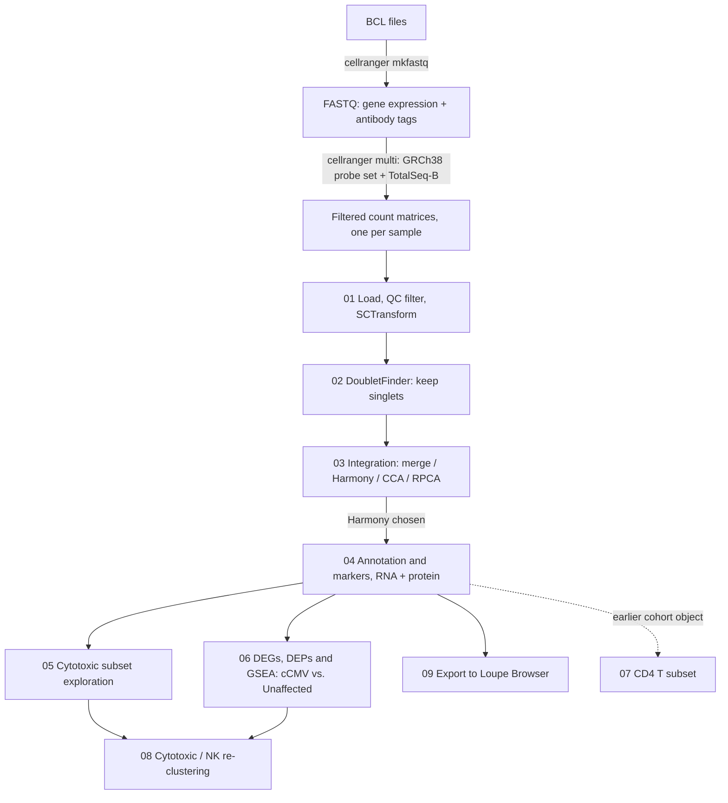

# cCMV CITE-seq analysis

Single-cell CITE-seq analysis of peripheral blood immune cells from infants with congenital cytomegalovirus (cCMV) compared with unaffected controls. Each library measures gene expression and surface protein in the same cells: 10x Genomics Chromium Flex (probe-based) gene expression plus antibody-derived tags (ADT) from the BioLegend TotalSeq-B Human Universal Cocktail V1. Data are processed with Cell Ranger `multi` and analyzed in R with Seurat v5.

The analysis covers QC, doublet removal, comparison of integration methods (merge, Harmony, CCA, RPCA), reference-based and manual cell-type annotation using RNA and protein together, differential expression of genes (DEGs) and proteins (DEPs) between cCMV and controls, pathway enrichment (GSEA), and focused re-clustering of cytotoxic (CD8 T / NK) and CD4 T cells.

## Pipeline overview



Each step is described in [Pipeline steps](#pipeline-steps) below.

## Repository layout

```
cCMV-CITEseq-analysis/
├── cellranger/
│   ├── mkfastq/        BCL → FASTQ (SGE job script + sample sheet)
│   ├── multi/          cellranger multi job scripts and config CSVs (GEX + ADT)
│   └── aggr/           cellranger aggr template
├── R/                  Seurat pipeline, run in numbered order
├── hpc/                SLURM test job template
├── results/
│   ├── figures/        qc/, integration/, annotation/, nk_cytotoxic/
│   └── tables/         marker tables and reference-label summaries
└── docs/
    └── references.md   papers and tools used
```

## Pipeline steps

### 1. Cell Ranger (v8.0.0)

| Step | Files | Notes |
|---|---|---|
| Demultiplex | `cellranger/mkfastq/run_cellranger_mkfastq.sh`, `SampleSheet.csv` | GEX index set SI-TS, ADT index set SI-TT |
| Count GEX + ADT | `cellranger/multi/*.sh`, `*.csv` | Reference `refdata-gex-GRCh38-2020-A`; probe set `Chromium_Human_Transcriptome_Probe_Set_v1.0.1_GRCh38-2020-A`; feature reference for TotalSeq-B Human Universal Cocktail V1 (399904) |
| Aggregate (optional) | `cellranger/aggr/aggregation.csv` | Template; replace `/path/to/` |

`multi_config.csv` is the same FF033_HS06 config written for a second cluster (different reference paths). Job scripts use SGE directives (`#$`); `hpc/slurm_test_job.sh` is a SLURM template.

### 2. Seurat (R)

Run from the project directory that contains `counts/` (Cell Ranger outputs) and `outs/`. Each script loads its own libraries and reads the `.rds` saved by the previous step.

| Script | What it does |
|---|---|
| `01_load_qc_normalize.R` | Reads `sample_filtered_feature_bc_matrix` per sample; RNA assay + ADT assay (`pex`); QC violins; filters 200 < nFeature < 6000, nCount < 25000, percent.mt < 5; per-sample SCTransform (glmGamPoi), PCA (30 PCs), clustering, UMAP |
| `02_doubletfinder.R` | pK sweep + DoubletFinder (pN 0.25, 7.5% expected doublets); keeps singlets; adds `sample` and `disease` metadata |
| `03_integration.R` | Compares plain merge, Harmony (by `sample`), CCA and RPCA; clustree over resolutions 0–1 |
| `04_annotation_markers.R` | Harmony object chosen; CLR normalization of ADT (margin 2); label transfer from PBMC references (L1–L3); RNA vs. protein marker panels; conserved markers and FindAllMarkers (RNA and ADT); heatmaps; manual annotation (`manual_id`) |
| `05_cytotoxic_subset_exploration.R` | Annotated UMAPs; first look at the cytotoxic (CD8 T / NK) subset |
| `06_differential_expression_gsea.R` | FindMarkers (Wilcoxon, min.pct 0.1, logFC 0.25) pairwise by sample and grouped cCMV vs. Unaffected, per cluster and per cell type, for RNA and ADT; fgsea with MSigDB Hallmark, GO:BP, GO:MF, C7 ImmuneSigDB, KEGG |
| `07_cd4_subset_and_earlier_cohorts.R` | CD4 T re-clustering and DE blocks written for an earlier cohort/object (`230330_CMV_harmony.rds`); kept for the record |
| `08_cytotoxic_nk_reclustering.R` | CD8 T + cytotoxic subset: re-normalize, Harmony, re-cluster, RNA/ADT markers, DEG/DEP, GSEA bubble plots, ridge/feature/violin plots |
| `09_export_loupe.R` | Template to export the Harmony object to a Loupe Browser `.cloupe` file with loupeR |

Create output folders before running (the scripts write into them but do not create them):

```r
dirs <- c("outs/objects", "outs/plots/annotation/FeaturePlots", "outs/plots/annotation/VlnPlots",
          "outs/plots/annotation/FeatureScatters", "outs/plots/annotation/cluster_highlights",
          "outs/degs/cluster_conserved/gsea", "outs/degs/pairwise/clusters/gsea",
          "outs/degs/pairwise/celltypes/gsea", "outs/degs/grouped/clusters/gsea",
          "outs/degs/grouped/celltypes/gsea", "outs/deps/pairwise/clusters", "outs/deps/pairwise/celltypes",
          "outs/deps/grouped/clusters", "outs/deps/grouped/celltypes", "outs/cytotoxic", "outs/CD4")
invisible(lapply(dirs, dir.create, recursive = TRUE, showWarnings = FALSE))
```

Scripts 07 and 08 also write to `outs/pex/` and `cytotoxic/`; create those subfolders as needed.

## Samples (scripts 01–06)

| Sample | Group | Cell Ranger library |
|---|---|---|
| CMVC087 | cCMV | FF029 |
| CMVC089 | cCMV | FF030 |
| CMVC103 | cCMV | FF031 |
| CMVC150 | cCMV | FF025 |
| CON0171 | Unaffected | FF026 |
| CON0178 | Unaffected | FF027 |
| CON0185 | Unaffected | FF032 |
| CBD01 (cord blood donor) | Unaffected | FF028, commented out / excluded |

FF033_HS06 has Cell Ranger configs here but is not yet in the Seurat scripts. Update this table as samples are added. Some figures in `results/` come from analysis runs that included additional samples.

## Requirements

Cell Ranger 8.0.0. R with Seurat v5 and: tidyverse, patchwork, Matrix, sctransform, glmGamPoi, DoubletFinder, KernSmooth, ROCR, fields, clustree, harmony, SeuratData, msigdbr, fgsea, data.table; loupeR for script 09. Recording exact versions is recommended, for example with `renv::snapshot()` or by saving `sessionInfo()` to `docs/sessionInfo.txt`.

## Data not stored in this repository

Raw and processed data are not tracked by git (see `.gitignore`): BCL/FASTQ files, Cell Ranger outputs, count matrices, `.rds` objects, `.h5` files, and Loupe `.cloupe` files. These are large, and they contain participant-level data from human subjects, so sharing them follows the study's IRB and data-use requirements. Raw data will be deposited in a controlled or public archive (for example GEO or dbGaP) at publication. Add the accession here when available.

Cell Ranger reference files (genome, probe set, probe metadata, TotalSeq-B feature reference) are available from 10x Genomics and BioLegend and are not included.

### Loupe Browser file

The Harmony-integrated object was exported to a `.cloupe` file (see `R/09_export_loupe.R`). GitHub rejects files over 100 MB, so the file is not in the git history. Options for sharing it:

1. Attach it to a GitHub Release of this repository (Releases accept individual files up to 2 GB), if it can be shared publicly.
2. Store it on institutional storage (Box, OneDrive, a lab server) or Zenodo/Figshare and link it here: *link: TODO*.

## Known issues in the code

These were found while preparing the repository and have not been changed in the scripts, so the code reflects what was run.

1. `02_doubletfinder.R`: the doublet bar chart counts cells using a hard-coded column, `DF.classifications_0.25_0.05_727`, which only exists for one sample. Other samples get zero counts, which gives empty plots. Singlet removal uses the correct, per-sample column, so the filtering itself is unaffected. Fix: `col <- paste0("DF.classifications_0.25_", pk, "_", nExp_poi)` and count with `data@meta.data[[col]]`. The `ggsave()` call there also builds the file name from `plot` (the ggplot object) instead of `plots` (the folder).
2. GSEA blocks in `06` and `08` filter genes with `markers$avg_log2FC <= 0.05` before ranking. This keeps only negative or near-zero fold changes, so enrichment is computed on down-regulated genes only. The intended filter was probably `p_val_adj <= 0.05`, or no filter with all genes ranked by fold change.
3. GSEA on conserved markers in `04` ranks genes by `max_pval`, which has no direction, so the sign of NES is not interpretable.
4. In `08`, the DEG/DEP bar-chart blocks create a 6-column data frame but assign 3 column names, which errors in R. The DEP block also assigns down-regulated counts to "upregulated" and vice versa.
5. `08` sets `outs <- "/outs"` (the filesystem root); `"./outs"` was probably intended.
6. Cluster-highlight loops use fixed cluster numbers, so a cluster that does not exist gives a blank image. Looping over `levels(data$seurat_clusters)` avoids this.
7. `fgseaMultilevel()` ignores `nPerm`. Newer msigdbr releases renamed the `category`/`subcategory` arguments and the KEGG collection, so those calls may need updating.
8. Paths are hard-coded to the original servers (`~/CMVC7/...`, `/igm/home/...`, `/igm/projects/...`) and need editing on other systems.

## Changes from the original files

The R code was originally kept in two Word documents (`Seurat.docx`, `Seurat_cytotoxic.docx`). It was copied verbatim into `.R` files and split at the points where each stage reloads its saved object. The only edits: a header comment and setup block added to each script, a `readRDS()` added at the top of script 06 so it runs on its own, and a few lines commented out that would otherwise stop R from parsing the file (marked `# [repo cleanup]`). Line endings were normalized to LF.

## References

See [`docs/references.md`](docs/references.md).

## Contact

*Name, lab, email: TODO*

## License

No license has been chosen yet, so all rights are reserved by default. The code may be viewed, but please contact the authors before reusing, modifying, or redistributing it.
